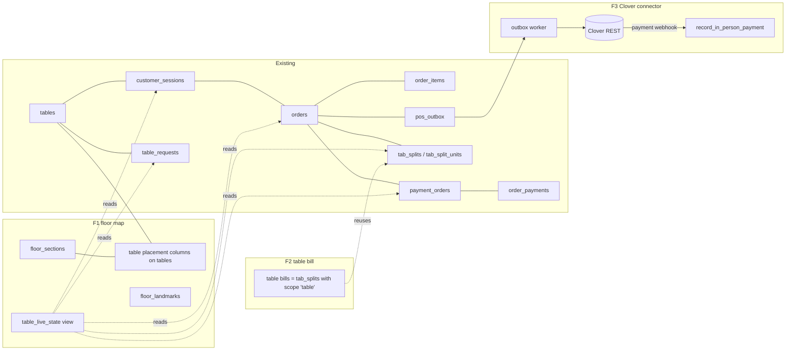
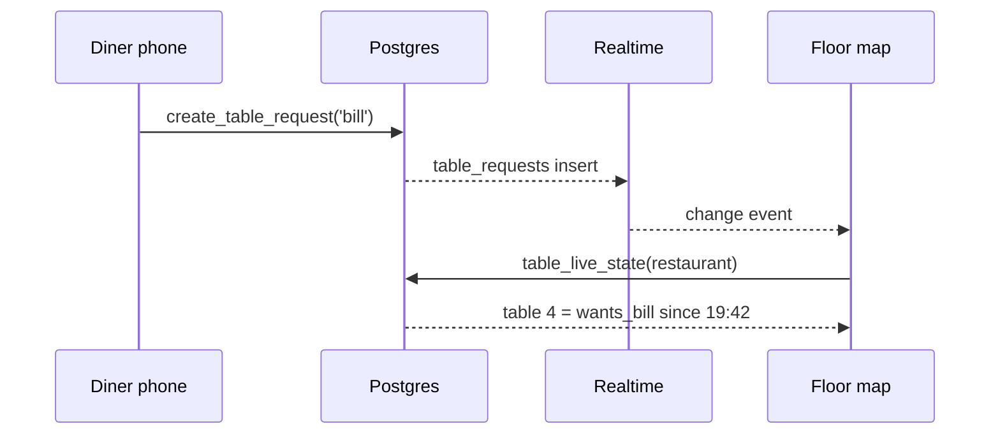
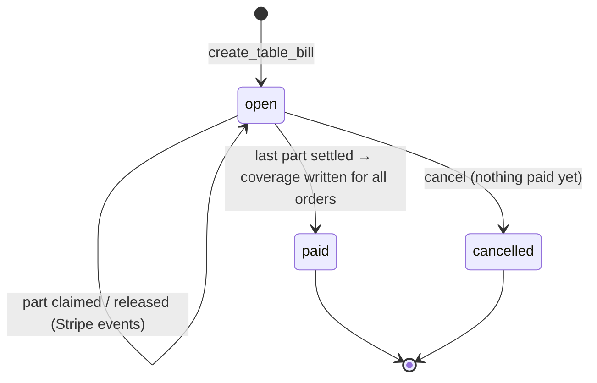

# Architecture

All designs are **proposed**. Existing pieces are named by file.

## Where each feature sits

## F1: Floor map

**Layout is data on the table, not a second copy of the table.** The placement columns go on
`tables`, not into a separate table. A table has exactly one position, and a separate row could
drift from it or be missing. Sections and landmarks are new tables, because they're things of
their own.

**Live state is computed, never stored.** `table_live_state(restaurant_id)` is a read-only
function returning one row per table: its state, when it entered it, and the unpaid total. It
uses the same "paid = a succeeded payment covers it" rule as `unpaid-orders.ts`. Storing a state
column would create a second answer to "is this table paid?", which this codebase deliberately
refuses everywhere else (see the header of `20260902090000_tab_payments.sql`).

**Live updates** use the Realtime and resync pattern already used by the kitchen board. The map
listens to the tables the state depends on (orders, payments, requests, sessions) and re-runs
the function, instead of patching state in the browser, so the screen can never drift into a
state the server wouldn't compute.

## F2: Table bill

**Reuse the split machinery and widen its scope.** Split bills already solve the hard parts:
freezing orders, exact allocation, "nothing paid until everything is", and blocking other payment
paths with a trigger. A table bill is a split whose orders come from **every session at a table**
instead of one. The proposal adds a `scope` (`'session' | 'table'`) to `tab_splits` and a
`table_id`, so:

- `allocate_minor`, `tab_split_units`, `start_split_payment` and the webhook path stay unchanged;
- the existing `payment_orders` BEFORE INSERT trigger already refuses any other payment for those
  orders, and covers all three of today's paths (one order, whole tab, cash);
- **Pay all** is a split with a single unit.

**Identity stays derived.** `create_table_bill()` takes no table ID. It reads the caller's own
active session, as `create_tab_split` does, and takes that session's table. Staff-started bills
take the table ID but check `is_restaurant_member`. A diner can never create a bill for a table
they aren't sitting at.

**The privacy boundary is the function's return shape.** Other phones' lines are returned as
`{guest_label, item_name, quantity, line_total}`, with labels assigned in session start order.
No session or user IDs. RLS on orders stays per session, and the function is the only way to see
another phone's lines.

## F3: Clover connector

Follows `docs/pos-integration.md` exactly. A worker reads `pos_outbox`, applies the
retry policy in `src/lib/pos/outbox-core.ts`, and calls Clover REST with the token named by
`credentials_ref`.

- **Outbound:** create the order with `state: "open"` and `externalReferenceId`, then the line
  items, converting with the same minor-units rule as `to_minor_units`. Store the Clover order ID
  on the Tableside order once the call succeeds.
- **Inbound:** a Clover payment webhook goes to a new route, which verifies Clover's signature,
  looks up the order by `externalReferenceId`, and records the coverage. It's idempotent on the
  Clover payment ID, in the same spirit as the outbox's `UNIQUE (order_id, event_type)`.
- **Never:** Clover credentials in a Postgres column; Clover able to mark a Stripe card payment
  refunded.
