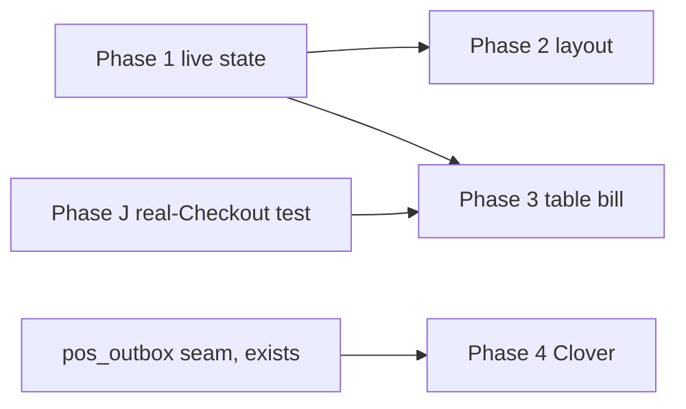

# Build plan

Ordered by value ÷ risk. Every phase ships alone and leaves `main` releasable.

## Phase 1: F1a, live table state (read-only, no layout)

**Why first:** no money code, no new writes, and useful at every restaurant on day one. The list
view (FEATURES.md, "No layout yet") is the whole screen at this stage.

- Migration: `table_live_state()` with its rule order; revoke `anon`.
- `/dashboard/floor` list view, sorted by urgency, live through Realtime with resync.
- **Done when:**
  - database tests cover each of the 10 states and the rule order (F1-1, F1-2, F1-3);
  - a state that depends on payment agrees with `getUnpaidOrdersByTable` for the same data, in a
    test that runs both;
  - F1-5 (kitchen role read-only) and F1-6 (resync) pass in E2E on the disposable project
    (`iriwghorcramhpmekktq`), never production.

## Phase 2: F1b, floor layout

- Migration: `floor_sections`, the placement columns on `tables`, `floor_landmarks`, and
  `save_floor_layout()`.
- Editor page with a keyboard alternative. Grid view on Floor, tray for unplaced tables.
- **Done when:** overlap, cross-restaurant and off-grid saves are refused in database tests; a
  restaurant with no layout still gets the Phase 1 list; F1-4 passes; the editor passes the
  existing accessibility checks, including keyboard-only placement.

## Phase 3: F2, table bill

**Highest risk, because it's money.** Builds on split bill (phase J), which is still "not yet
tested with a real Stripe Checkout" (`docs/COMPETITIVE_ROADMAP.md`). **Do that real-Checkout test
first.** Don't widen code that hasn't been proven live.

- Migration: the `tab_splits` scope columns, the one-open-per-table index, the nullable creator
  change, and the four functions.
- Diner Pay for the table, the notice on other phones, and staff Start table bill from the Floor
  panel.
- **Done when:**
  - the property tests over thousands of totals (as for phase J) pass for table bills: the parts
    sum to the bill and every order's coverage sums to its total;
  - F2-1 to F2-6 pass, with F2-6 checked by asserting on the function's return shape;
  - one real live Checkout of a two-phone table bill at a test restaurant, then a refund.

## Phase 4: F3, Clover connector (Nashta)

- Outbox worker plus a Clover client (sandbox first), the OAuth callback at
  `/api/pos/clover/callback`, and the inbound payment webhook.
- **Done when:** F3-1 to F3-4 pass against the sandbox merchant; a duplicate webhook records one
  payment; a token stored anywhere but the secret store fails review.
- **Before production:** confirm with Clover developer relations whether a private app needs
  approval (an open question in the Clover project notes).

## Dependencies

Phase 4 doesn't depend on 1–3 and can run in parallel if Nashta needs it sooner.
