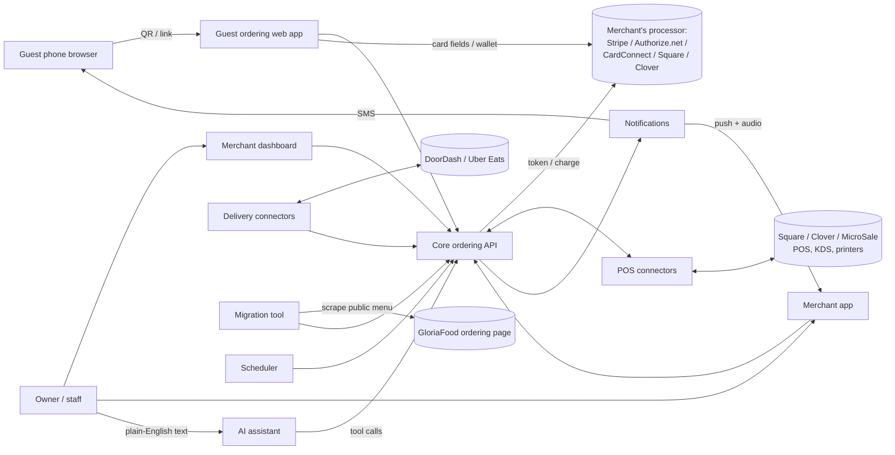
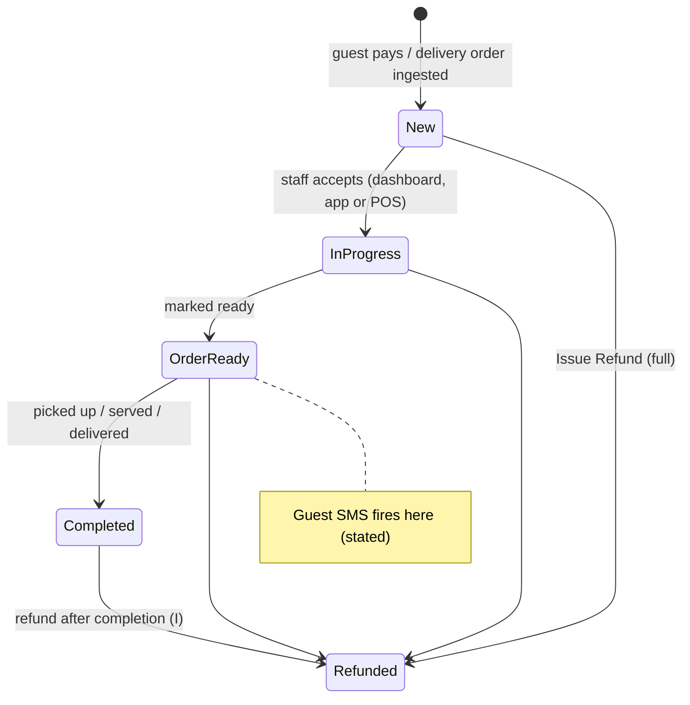
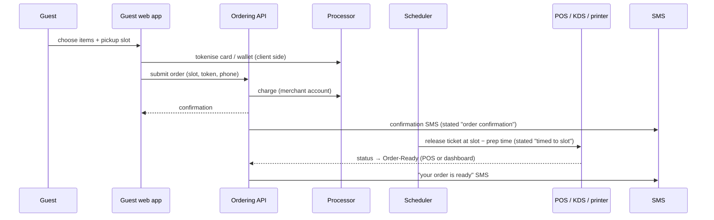
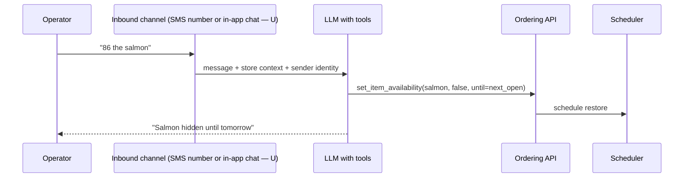

# Ogent.AI — architecture (inferred)

**No client code, network traffic or binary was inspected** (see
[EVIDENCE_AND_UNKNOWNS.md](EVIDENCE_AND_UNKNOWNS.md)). Everything below is **inferred** from
product copy (E01–E17). Boundaries that the copy states directly (for example "Ogent does not
store card data") are marked **stated**. Framework, hosting, database and language are all
**unknown**.

## Components

| #   | Component                  | Responsibility                                                                  | Basis                                      |
| --- | -------------------------- | ------------------------------------------------------------------------------- | ------------------------------------------ |
| C1  | Marketing site `ogent.ai`  | SEO pages, comparisons, onboarding entry                                        | Observed URLs (E03)                        |
| C2  | Blog `restaurant.ogent.ai` | Content marketing                                                               | Observed URL; WordPress-like slugs (I)     |
| C3  | Guest web ordering app     | Table QR, counter QR, branded storefront; checkout                              | Stated "in the browser, no download" (E04) |
| C4  | Merchant web dashboard     | Menu, hours, delivery zone, orders, refunds, analytics                          | Stated (E02)                               |
| C5  | Merchant mobile app        | Order feed, push/audio alerts, auto-print, snapshot, menu edit, biometric login | Play listing `com.ogentai.operator` (E13)  |
| C6  | Core ordering API          | Menu, cart, orders, status machine, slots, refunds                              | Implied by C3–C5 sharing state (I)         |
| C7  | POS connectors             | Square / Clover / MicroSale menu import, order push, status read-back           | Stated (E09)                               |
| C8  | Delivery connectors        | DoorDash, Uber Eats order ingest (and probably dispatch)                        | Stated (E09)                               |
| C9  | Payment gateway adapters   | Stripe, Authorize.net, CardConnect, Square/Clover payments                      | Stated (E01, E09)                          |
| C10 | Notification service       | Guest SMS (confirm, ready, delay); merchant push                                | Stated (E07, E13)                          |
| C11 | Operator AI assistant      | NL command → menu / availability / pause mutations                              | Stated (E02, E06)                          |
| C12 | Menu migration service     | `migrate-to.ogentai.com`; scrape GloriaFood link → LLM → menu                   | Stated (E11); mechanism inferred           |
| C13 | Scheduler                  | Auto-restore 86'd items next day; pause expiry; slot-timed ticket release       | Implied by rules (I)                       |
| C14 | Analytics                  | Aggregates over orders and customers                                            | Stated (E02)                               |

## Context diagram

## Order lifecycle (stated statuses, inferred transitions)

Partial refunds (by item) are an action on the order, not a separate status (I).

## Pickup slot flow (inferred sequence)

## AI assistant flow (inferred)

## Boundaries and trust

| Boundary                | Known                                                                                                                  |
| ----------------------- | ---------------------------------------------------------------------------------------------------------------------- |
| Card data               | **Stated:** Ogent is a conduit only and does not store card data (E16). Implies gateway-hosted fields or tokenisation. |
| Money flow              | **Stated:** no Ogent processor; payouts follow the merchant's processor (E17). Platform fee collection is U.           |
| POS as system of record | **Inferred:** menu sourced from the POS; orders written back; status read back for SMS.                                |
| Guest identity          | **Inferred:** phone number (SMS + "Customers (Top Spend)"); no guest accounts.                                         |
| Merchant auth           | U (biometric unlock on the app is stated, E13; underlying auth unknown).                                               |
| Multi-tenancy           | **Inferred:** one platform, many stores (300+ claimed).                                                                |

## Background work, caching, offline

- **Scheduled jobs (I):** next-day restore of 86'd items, pause expiry, slot-timed ticket release,
  and probably periodic POS menu re-sync (Clover "live price sync" suggests webhooks or polling).
- **Realtime (I):** live order feed and audio alerts need push (FCM/APNs for the app; websocket
  or SSE for the dashboard).
- **Offline:** U.
